# 📚 Readr - Turn pages into progress

[](https://conorgregson.github.io/reading-log-app/)


[](./LICENSE)

Minimal, offline-first reading log with JSON backup/import, security policy, and contributor-friendly docs.

🔗 **[Full Documentation →](./docs/)**

---

## Live Demo

**▶ Try it now:** https://conorgregson.github.io/reading-log-app/

> Data is saved locally in your browser via `localStorage` and is separate from your local dev data.

---

## 📑 Table of Contents

- [About](#-about)
- [Features](#-features)
- [Tech Stack](#️-tech-stack)
- [Roadmap](#-roadmap)
- [Installation & Usage](#-installation--usage)
- [Screenshots](#-screenshots)
- [Contributing](#-contributing)
- [Author](#-author)
- [License](#-license)

---

## ℹ️ About

**Readr** is a lightweight, browser-based reading log.
Built with vanilla JavaScript, HTML, and CSS, it helps you track your books without external accounts, sync, or setup.

---

## ✅ Features

### 📚 Book Management

- Add, edit, and remove books from your library
- Track reading status (Planned, In Progress, Finished)
- Organize and browse with search, filters, and saved search presets

### 📝 Reading Sessions & Goals

- Log reading sessions with minutes and optional notes
- Daily & weekly goals with progress tracking
- Automatic streak calculation and reading summaries
- Keyboard shortcut to jump straight to Session History search

### 🔄 Backup & Import

- Export your full reading data (books + sessions) as JSON
- Import backups with validation and auto-normalization
- Import error handling for malformed or outdated data

### 📊 Reading Statistics (New in v1.9.0)

- Per-day trend chart showing your reading activity over time
- Top Books chart (minutes/pages read per book)
- Both charts include accessible text summaries for screen-reader users
- Charts update instantly when sessions change

### 🖼️ Shareable Snapshot (New in v1.9.0)

- Generate a clean progress snapshot card
- Export snapshot to PNG for sharing
- Theme-aware visuals (light/dark mode)
- Dynamic logo switching for contrast
- Shows trends, books completed, streaks, and total reading time

### 🎖️ Badges

- 12 built-in achievement badges
- Live-updating “X of 12 unlocked” summary
- Primary-color highlight for unlocked badges
- Accessible announcements when new badges are earned

### ♿ Accessibility

- ARIA live regions for charts, badges, Snapshot, and search
- Keyboard navigation and improved focus handling
- High-contrast visuals in dark & light themes

### 💾 Data Persistence

- Fully offline
- All reading data stored in `localStorage`

---

## 🛠️ Tech Stack

- **Frontend:** HTML, CSS, Vanilla JS
- **Storage:** LocalStorage + JSON import/export

---

## 🗺️ Roadmap


See the full [Roadmap](./docs/roadmap.md) for milestones and timelines.

---

## 🚀 Installation & Usage

1. **Clone the repository**
   ```bash
   git clone https://github.com/conorgregson/reading-log-app.git
   cd reading-log-app
   ```
2. **Open the app**
   Simply open the `index.html` file in your browser.

   - No build steps or dependencies required.
   - Works entirely offline with `localStorage`.

3. **Start using the app**
   - Add, edit, or remove books from your log.
   - Track your reading progress and completion.
   - Backup and import your log as JSON files

---

## 🔄 What's New in v1.9.0 — Visualization & Motivation

Readr v1.9.0 introduces the first major step toward visual insights and motivation-driven reading.
This update adds charts, shareable progress snapshots, keyboard shortcuts, and meaningful accessibility upgrades.

### 📊 Reading Statistics (New)

- Per-day reading trend chart with accessible text summaries
- Top Books chart showing reading time distribution across finished books
- Charts automatically update when sessions change
- Fully keyboard-accessible and screen-reader-friendly

### 🖼️ Shareable Snapshot (New)

- Export a PNG snapshot of your reading progress
- Theme-aware visuals (light/dark mode supported)
- Displays trend summary, streak, books count, and reading totals
- Dynamic logo that adapts to current theme for clean exports

### 🎖️ Badge Improvements

- Badge summary (“X of 12 badges unlocked”) updates live
- Unlocked badges now highlight correctly with primary color
- Improved contrast and readability across both themes
- Accessibility support for badge unlock announcements

### ⌨️ Productivity & A11y Enhancements

- Keyboard shortcut to jump directly to Session History search
- Help hint under the log form when shortcuts are enabled
- ARIA live regions for charts, Snapshot trend text, and badges summary
- Snapshot theming fixed so it always matches current appearance mode

---

## 📸 Screenshots

> _Updated for **v1.6.0 — Search & Filters**_

### Main UI

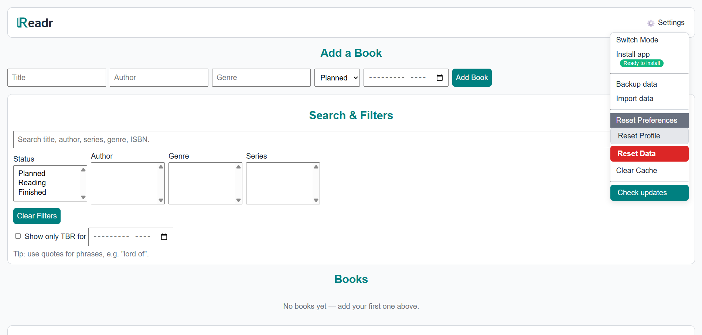

### Goals & Sessions

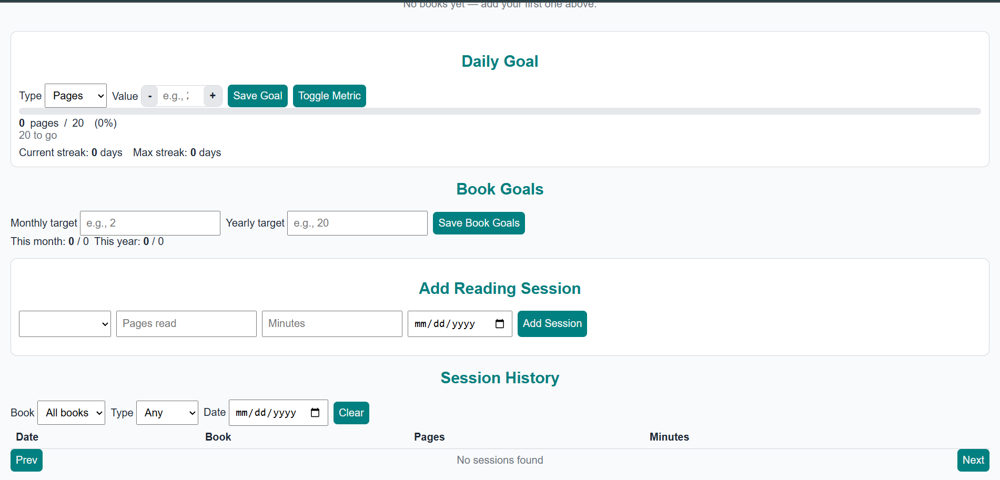

### Books List (populated)

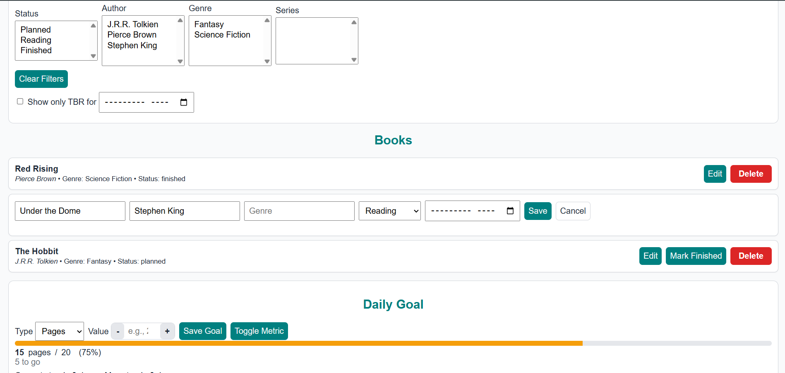

### Bulk Edit Dialog

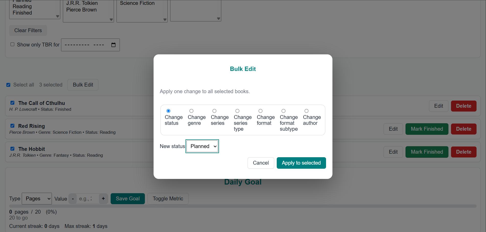

### Dark Mode

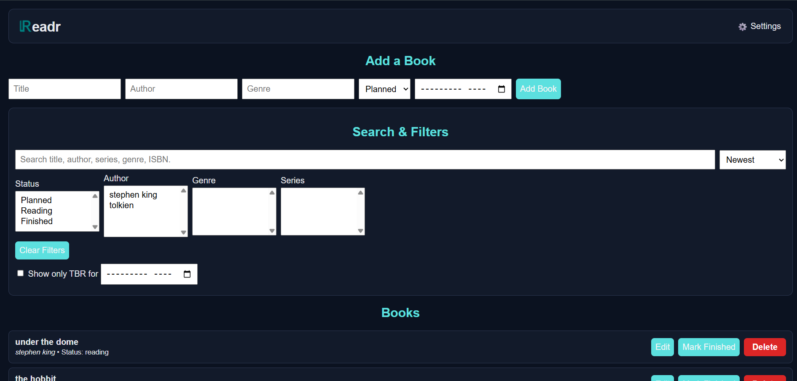

### Settings Dropdown

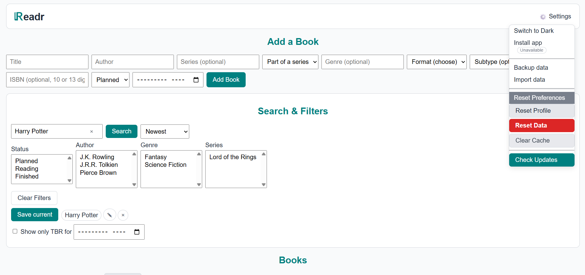

### Search & Filters

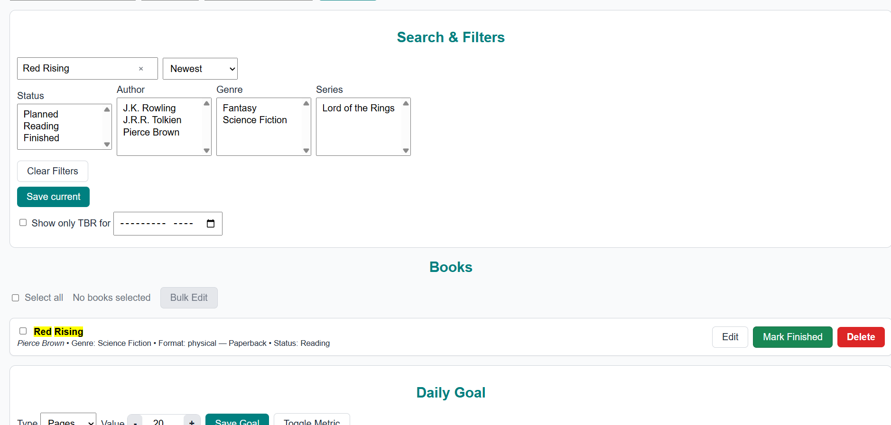

### Multi-Select Filters

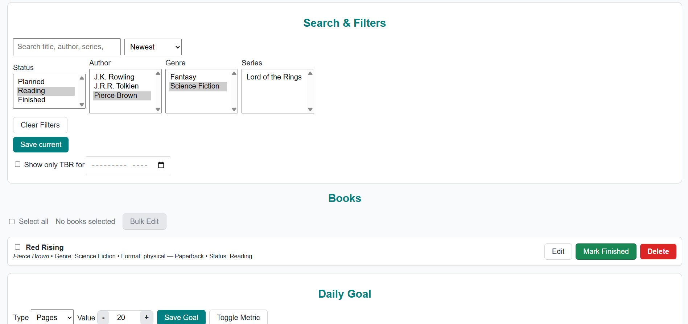

### Saved Searches

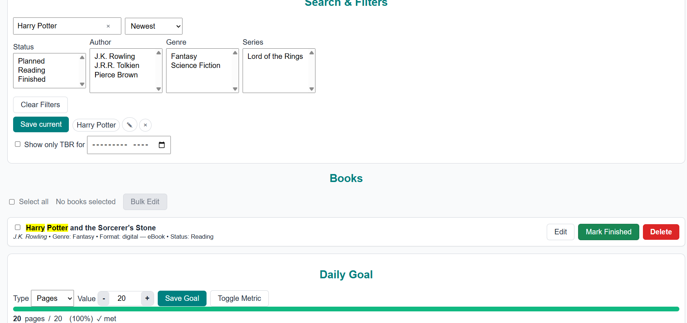

### Search Results Example

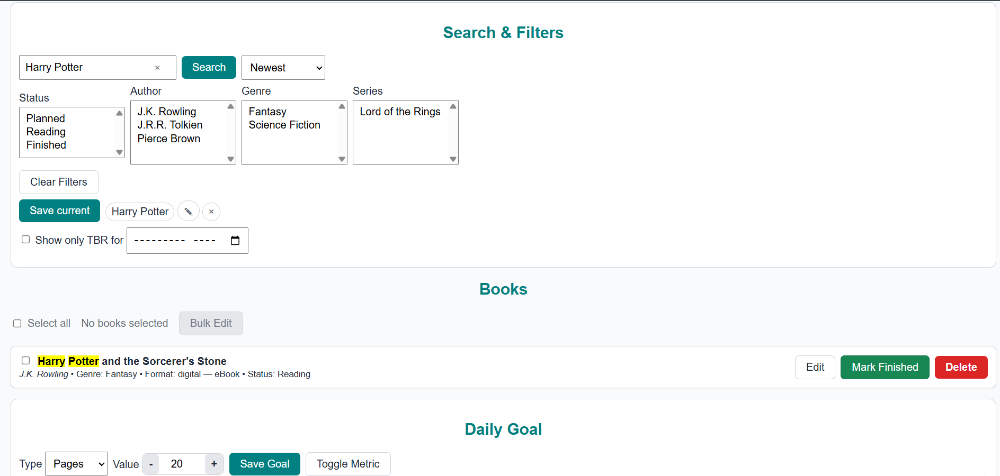

### Installed App View

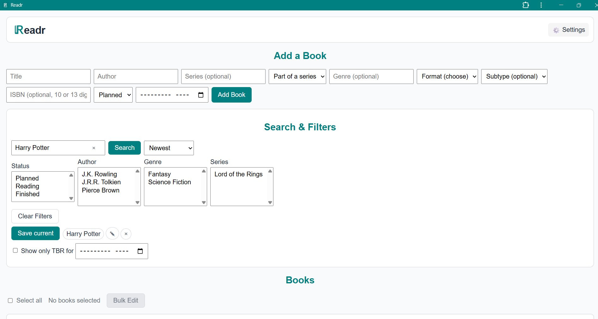

---

## 📖 Documentation

Full project documentation is available in the [/docs](./docs/) folder:

- [Getting Started](./docs/getting-started.md) — installation & usage
- [Features](./docs/features.md) — current and planned features
- [Design Decisions](./docs/design-decisions.md) — architecture choices & trade-offs
- [Roadmap](./docs/roadmap.md) — milestones & timelines
- [Troubleshooting](./docs/troubleshooting.md) — common issues & fixes
- [Brand Assets](./docs/BRAND-ASSETS.md) — logos, color, usage guidelnes
- [Progressive Web App (PWA)](./docs/PWA.md) — install guide, offline features, roadmap

---

## 🤝 Contributing

Contributions, issues, and feature requests are welcome!

- Check the [issues page](https://github.com/conorgregson/reading-log-app/issues)
- Open a [pull request](.github/pull_request_template.md) with improvements

Quick start for contributors:

1. Fork the repo
2. Create your feature branch (`git checkout -b feature/my-feature`)
3. Commit your changes (`git commit -m "feat: add my feature"`)
4. Push to branch (`git push origin feature/my-feature`)
5. Open a Pull Request

---

## 📧 Author

Made by Conor Gregson

- [GitHub](https://github.com/conorgregson)
- [LinkedIn](https://www.linkedin.com/in/conorgregson)

---

## 📜 License

This project is licensed under the **GNU General Public License v3.0 (GPL-3.0)**.
See the [LICENSE](./LICENSE) file for details
